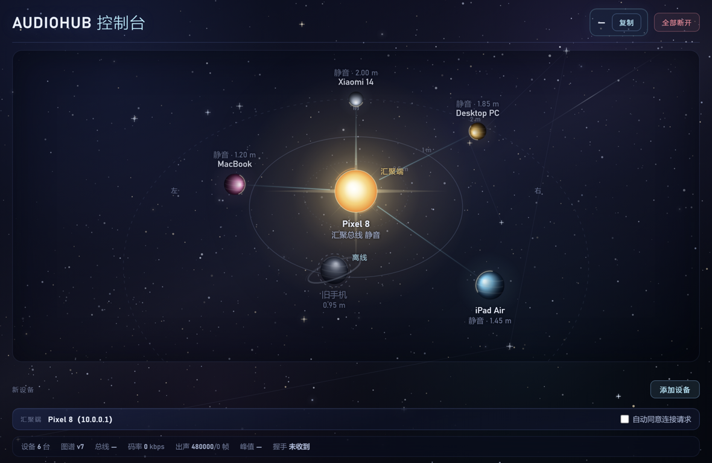
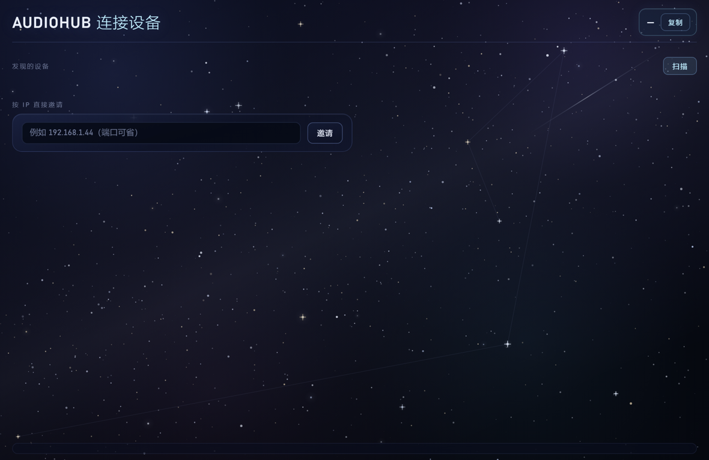

# AudioHub — 跨端音频汇聚系统

把多台设备**各自正在播放**的声音，同时送到**同一副耳机**里。

- 拓扑：**N 个源 → 1 个输出端**（不是多房间同步播放，那个方向是反的）
- 输出端：Windows PC（已实现）、Android（已实现，另一台手机也能当汇聚端）
- 声源端：Windows PC / Android 手机
- 首要指标：低延迟、音画同步

> 完整的方案调研、竞品对比、延迟预算与取舍分析见
> [`docs/跨端音频汇聚系统-技术调研与架构设计.html`](docs/跨端音频汇聚系统-技术调研与架构设计.html)



---

## 目录

- [下载](#下载)
- [怎么用（三步）](#怎么用三步)
- [界面](#界面)
- [距离就是音量](#距离就是音量)
- [现状](#现状)
- [架构](#架构)
- [构建](#构建)
- [命令行](#命令行)
- [协议](#协议)
- [关键设计决定](#关键设计决定都有代价写清楚)
- [前后方位是怎么做的](#前后方位是怎么做的)
- [已知限制](#已知限制)
- [排错](#排错)
- [路线](#路线)
- [参考](#参考)

---

## 下载

### 最新版：v0.46

| 文件 | 平台 | 大小 | 说明 |
|---|---|---|---|
| [AudioHub-Setup-0.46.0.exe](https://github.com/huashu-611/Cross-platform-audio-system/releases/latest/download/AudioHub-Setup-0.46.0.exe) | Windows 安装版 | 79.5 MB | 推荐。带开始菜单项、卸载程序，安装时自动加防火墙入站规则 |
| [AudioHub-Portable-0.46.0.exe](https://github.com/huashu-611/Cross-platform-audio-system/releases/latest/download/AudioHub-Portable-0.46.0.exe) | Windows 便携版 | 79.2 MB | 单文件免安装，双击即用。内含 Electron 运行时 + C++ 音频核心 |
| [AudioHub-Source-0.46.apk](https://github.com/huashu-611/Cross-platform-audio-system/releases/latest/download/AudioHub-Source-0.46.apk) | Android 10+ (API 29) | 450 KB | 手机端。既能当声源，也能当接收端 / 汇聚端 |

便携版只是个"果壳"：窗口里跑的是本仓库的网页界面，音频仍然是同一套 C++ 核心
（打包在 exe 内，启动时释放到临时目录运行）。

### 完整性校验（SHA-256）

```
8a66e14a530f8b7d1e466fdc311f71c6f7123a4aca72a9b4f8e6b1df6ea4d4e2  AudioHub-Setup-0.46.0.exe
2143b95712391c64f7d8811624efed8f792c1b5c45abb83ac51c36f05c906cc7  AudioHub-Portable-0.46.0.exe
ef6ca289dc10cc09a65cce285a77168f1877dfa2655a33c48a9d89fbfee14b1e  AudioHub-Source-0.46.apk
```

Windows 自带工具核对：

```powershell
Get-FileHash .\AudioHub-Portable-0.46.0.exe -Algorithm SHA256
```

> **APK 签名**：从 v0.36 起签名 key 固定，可以直接覆盖升级。
> 证书 SHA-256 指纹恒为
> `5dbe36c19e2e5ce2bdf6959abde20628e6e02187e68901edecd815e258897e7`。

---

## 怎么用（三步）

### 1. 电脑：打开 AudioHub

双击 `AudioHub-Setup-0.46.0.exe` 安装后运行，或直接双击便携版。
窗口顶部会显示**手机上该填的 IP**，点「复制」即可。

程序会自动做三件事：启动 C++ 音频核心、起本地 HTTP 控制口（`127.0.0.1:4780`）、
打开界面窗口。

### 2. 手机：装 APK，填 IP

```bash
adb install -r AudioHub-Source-0.46.apk
# 或把 apk 拷到手机上，用文件管理器点开安装（需要允许"未知来源"）
```

打开后连接页会自动扫描局域网里的设备。广播被拦的网络（办公 / 校园 WiFi 常见）
点「手动添加」直接填电脑 IP。

### 3. 手机点「送入」，授权

点「送入」后系统会弹出「屏幕录制」授权 —— **Android 的音频采集挂在 MediaProjection 上，
不授权就没法抓，但它真的不会录屏**（只抓音频，不产生任何图像）。通知栏会出现
「AudioHub 正在采集」的常驻通知。

手机放歌，电脑的耳机里就能听到。

> **手机和电脑必须在同一个局域网 / 同一网段。**
> 第一次收不到声音，八成是 Windows 防火墙 —— 见[排错](#排错)。

### 反过来：手机当输出端

在电脑界面里右键点击手机那颗星球 → 「切换汇聚端到此设备」，声音就搬到手机喇叭上。
切换后立即生效，并会把新图谱广播给所有设备，其它电脑/手机的界面会在 1~2 秒内自动跟着变。

---

## 界面

### 连接页



### 控制台

界面中央是**全网共享的设备图谱**：网络里每台设备（PC / 手机）都是图上的一个球，
汇聚端是中央的恒星。

| 操作 | 效果 |
|---|---|
| 左键拖动小球 | 在地面上摆位（**距离就是音量**） |
| 左键拖动空白处 | 旋转视角 |
| 滚轮 | 缩放（1.45 m – 6.2 m，4.28 倍范围） |
| 右键点小球 | 节点菜单：切换汇聚端到此设备 / 位置复位 |
| 右键点恒星 | 额外有「所有设备位置复位」 |

图谱是**物理房间**的俯视投影（1 格 = 1 m）：听者固定在原点，球在地面上自由摆位。

**球的屏幕大小严格正比于 1 / 相机距离** —— 没有像素夹紧，缩放时球和间距一起等比变化
（hub : node 的像素比恒为 `1.904762`）。这样"远"永远只意味着"远"，不会被渲染规则骗。

位置是**全网一份**：拖完写进本机内核，再由 POS 帧同步给所有电脑和手机
（[协议 §13](docs/GRAPH-PROTOCOL.md)）。手机端用同一个坐标系画俯视星图，只读。

窗口顶部直接显示**手机上该填的 IP**，点「复制」即可。
整个界面随窗口自适应，不出现滚动条。

---

## 距离就是音量

**没有音量滑杆。** 把球拖近就响，拖远就轻。

```
g = min((0.3 / max(d, 0.3)) ^ 2.4274533, 1.0)
```

| 距离 | 增益 | dB |
|---|---|---|
| ≤ 0.30 m | **100.00%** | 0.00 |
| 0.40 m | 49.74% | −6.07 |
| 0.50 m | 28.94% | −10.77 |
| 0.75 m | 10.81% | −19.32 |
| 1.00 m | 5.38% | −25.39 |
| 1.50 m | 2.01% | −33.93 |
| **2.00 m** | **1.00%** | **−40.00** |
| 3.00 m | 0.37% | −48.55 |
| 10.0 m | 0.02% | −73.93 |

- **锚点**：0.3 m = 100%，2 m = 1%。指数由这两点反解：`p = ln(0.01) / ln(0.3/2.0)`。
- **近场封顶**：0.3 m 以内一律 100%（不升压）。以前有过 +6 dB 的近场升压，已取消。
- **远场不截断**：没有最大距离下限，拉得再远也只是越来越轻。

> ⚠️ **这条曲线动态范围很大**：2 m 处 −40 dB，普通播放音量下基本听不见。
> 想让远处也可闻，应该整体提高各源音量（`user_gain`，可用范围 0～+12 dB），
> 而不要改这条曲线的口径 —— 否则"距离即音量"就没有物理含义了。

同一套常数在 C++（`include/audiohub/spatial.hpp`）和 Java（`Spatial.java`）里各有一份，
两边逐位对齐（实测 7 位小数最大偏差 `2.325e-04 dB`）。

---

## 现状

| 能力 | 状态 | 说明 |
|---|---|---|
| UDP 传输协议（16 字节包头） | ✅ | `include/audiohub/packet.hpp` |
| 无锁 SPSC 环形缓冲 | ✅ | 设备回调只 memcpy |
| 每源独立抖动缓冲 | ✅ | 按绝对采样序号索引，支持部分迟到裁剪；目标水位自适应 |
| 时钟同步（ping/pong + 中位数） | ✅ | 实测回环 RTT 0.3~0.6 ms |
| ASRC 时钟漂移补偿 | ✅ | 4 点 Catmull-Rom，±0.2% |
| 外环：PI 锁水位 + 自适应目标 | ✅ | 锁到 `--latency`；增量欠载时自动抬目标（最多 +60 ms），稳定 10 s 后回落 |
| N 路混音 + 软限幅 | ✅ | float32 累加，阈值 0.85 |
| 双耳空间化（ITD + 等功率声像） | ✅ | 逐样本延时过渡，拖动不产生电流声 |
| 前后方位线索 | ✅ | 陷波 + 早期反射 + 对比度拉伸，见[下文](#前后方位是怎么做的) |
| WASAPI 系统音频采集 | ✅ | loopback + AUTOCONVERTPCM |
| 进程回环 `--include/--exclude` | ✅ | Win10 2004+，只抓/排除指定进程树 |
| WASAPI 低延迟输出 | ✅ | 事件驱动，默认 10 ms 缓冲 |
| 输出设备跟随系统默认 | ✅ | 每约 1 秒比对一次，插耳机自动改道 |
| Android 源端（采集） | ✅ 已真机验证 | `android/`，APK ≈ 450 KB |
| Android 接收端（播放/混音） | ✅ | `ReceiverService`：AudioTrack 混音输出 + 俯视星图 |
| Windows 图形界面 | ✅ | `ui/` Electron 壳，3D 星空房间视图 |
| PC 自己当音源 | ✅ | 非汇聚端时自动拉起 `audiohub-source`，连接后自动静音本机输出 |
| 本地 HTTP 控制接口 | ✅ | `--http-port 4780`；含 `/api/state.graph`、`/api/graph/switch`、`/api/graph/placement` |
| 共享网络图谱（双端） | ✅ | 全网同步（[协议](docs/GRAPH-PROTOCOL.md)） |
| 房间摆位全网同步 | ✅ | POS 帧广播，手机俯视图只读显示 |
| 设备发现 / 配对 | ✅ | UDP 广播发现 + 手工邀请 + 自动同意；未上 mDNS |
| 退出/掉线同步 | ✅ | 退出发 CONN-BYE 即时摘流；10 s 无报文转离线 |
| 防火墙自愈 | ✅ | 启动时检查入站 UDP 规则，缺了就补，补不上弹窗提示 |
| 内置信号源 `--tone` | ✅ | 无音频设备也能测；两路正弦叠加可数值验证混音 |
| 抖动注入 `--jitter` | ✅ | 模拟 WiFi，验抖动缓冲 |
| 电平表 | ✅ | 每路 + 混音总线 dBFS |
| 单元测试 | ✅ | **101 个用例 / 11020 条断言**，无需声卡 |
| Opus 编码 | ⬜ | 接口已预留，P0 用 int16 PCM |
| Android 低延迟输出 | ⬜ | 现用 AudioTrack，未上 AAudio |
| 蓝牙输出拦截 | ⬜ | 官方警告：蓝牙会 +150~250 ms |

**这不是完成品，是可运行的 P0 骨架。** 传输、缓冲、混音、时钟这几块核心逻辑是完整的，
平台适配和体验层还没做。

---

## 架构

```
 源 A (Windows)          源 B (Windows)          源 C (Android)
 WASAPI loopback         WASAPI loopback         AudioPlaybackCapture
      │                       │                       │
      ├─ int16 分包 ──────────┼───────────────────────┤
      │  16B 头 + 960B 载荷    │                       │
      ▼                       ▼                       ▼
 ┌──────────────────────────────────────────────────────────┐
 │  HUB (Windows / Android)                                 │
 │                                                          │
 │  [接收线程]  UDP → 解码 → 每源 JitterBuffer              │
 │                                    │                     │
 │  [混音线程]  每 5 ms: JB → ASRC → 求和 → 软限幅 → 输出环 │
 │                                    │                     │
 │  [渲染线程]  WASAPI 实时回调：只从输出环 memcpy          │
 │                                                          │
 │  [主线程]    统计 + 控制口 + 图谱合成                    │
 └──────────────────────────────────────────────────────────┘
                          │
                扬声器 / 3.5 mm / USB-C DAC
                （蓝牙耳机 = +150~250 ms，不要用）
```

线程划分的唯一原则：**硬实时只留给渲染回调**。它只做 `memcpy`，
不加锁、不分配、不打日志。其余所有工作都在普通线程上，晚了就晚了，
由输出环吸收。

### 端口一览

| 端口 | 用途 |
|---|---|
| 47000 | 音频数据（UDP）。手机上填的就是它 |
| 47001 | 控制 / 时钟同步（`port + 1`） |
| 47002 | 握手 / 图谱 / ROLE 指令（`port + 2`） |
| 47300 | 设备发现广播（UDP broadcast） |
| 4780 | 本地 HTTP 接口（TCP，只绑 127.0.0.1） |

### 代码地图

```
apps/          hub_main.cpp（命令行汇聚端）、hub_gui.cpp、source_main.cpp（采集端）
include/       15 个公共头文件（协议、抖动缓冲、ASRC、空间化、图谱…）
src/           11 个实现（hub_core.cpp 是核心，约 2600 行）
platform/win/  WASAPI 采集 / 输出、媒体文件解码
ui/            Electron 壳：main.js（进程）、renderer.js（界面）、scene3d.js（3D 投影）
android/       Java 源端 + 接收端 + 星图（详见 android/README.md）
tests/         12 个单测文件
tools/         构建、冒烟、验收、诊断脚本
```

---

## 构建

### Windows（MSYS2 / MinGW-w64，推荐）

```bash
# 安装工具链（只需一次）
pacman -S mingw-w64-ucrt-x86_64-gcc

# 没有 cmake 时用自带脚本（等价）
./build.sh

# 有 cmake 的话
cmake -S . -B build -G "MinGW Makefiles" -DCMAKE_BUILD_TYPE=RelWithDebInfo
cmake --build build -j
```

产物在 `build/`：

- `audiohub-hub.exe` — 汇聚端（命令行）
- `audiohub-source.exe` — 采集端
- `audiohub_tests.exe` — 测试

### 测试

```bash
./build/audiohub_tests.exe
# 或
ctest --test-dir build --output-on-failure
```

测试只覆盖平台无关的核心层，**不需要声卡**，可以在 CI 里跑。
当前基线：**断言 11020 条，失败 0 条，用例失败 0/101**。

### Windows 一键脚本（本项目的实测环境，无需 cmake）

```powershell
powershell -NoProfile -ExecutionPolicy Bypass -File tools\build.ps1            # 编译全部 + 跑单测
powershell -NoProfile -ExecutionPolicy Bypass -File tools\build.ps1 -Target tests  # 只跑单测
powershell -NoProfile -ExecutionPolicy Bypass -File tools\graph-smoke.ps1      # 图谱冒烟：两个 hub 互发 GRAPH
node tools\ui-e2e.js                                                          # Electron 界面端到端
node tools\audioflow-test.js                                                  # 音频流连续性与切换验收
powershell -NoProfile -ExecutionPolicy Bypass -File tools\probe-rx.ps1 -Secs 12  # 直连源端量时间轴空洞
```

> 脚本内部会先把 MSYS2 的 `bin` 加进 `PATH`、并统一用相对路径编译——
> MinGW 的 `ld` 处理带中文的绝对路径会直接失败（而且报错信息帮不上忙）。

### Android

```bash
cd android && VERSION_CODE=46 VERSION_NAME=0.46 bash ./build-apk-local.sh
```

走 aapt2 + javac(JDK17) + d8 + apksigner，**不依赖 Gradle**。

### 四套离线校验（Android 侧，纯 JDK 即可跑，不需要模拟器）

```powershell
powershell -ExecutionPolicy Bypass -File android\verify\run-spatial-check.ps1   # 23232 项
powershell -ExecutionPolicy Bypass -File android\verify\run-scene-check.ps1     # 403 项
powershell -ExecutionPolicy Bypass -File android\verify\run-graphfit-check.ps1  # 257 项
powershell -ExecutionPolicy Bypass -File android\verify\run-jitter-check.ps1
```

这几个脚本把 `Scene3D.java` / `GraphFit.java` / `Spatial.java` / `JitterBuffer.java`
直接从源码编译成普通 Java 程序运行，**判定基准是 C++ 侧导出的黄金值**
（`build/_plan/android_golden.js` 生成 `android_golden.json`），所以能抓住
"Java 悄悄和 C++ 漂移"这类最难发现的缺陷。

### 打 Electron 包

```bash
cd ui && npm install
cd ui && npm run dist        # 产物：ui/dist/AudioHub-便携版.exe
```

> **两个环境坑（都会以莫名其妙的错误呈现）**
>
> 1. 某些 Electron 宿主环境会给子进程设 `ELECTRON_RUN_AS_NODE=1`，
>    Electron 就退化成纯 Node，`require('electron')` 返回的是二进制路径而不是 API。
>    表现是 `Cannot read properties of undefined (reading 'whenReady')`。
>    先 `unset ELECTRON_RUN_AS_NODE` 再启动。main.js 里已加针对性报错。
> 2. 虚拟机 / 无 GPU 环境里 Chromium 的 GPU 进程会崩溃，整个应用起不来。
>    开发态用 `npm run start:sandbox-off`；打包好的便携版加参数
>    `--no-sandbox --disable-gpu` 启动。正常 PC 不需要。

---

## 命令行

### 汇聚端（出声的那台）

```bash
audiohub-hub.exe --port 47000 --latency 60
# 启动后会打印本机 IP，例如 192.168.1.20
```

### 源端

```bash
audiohub-source.exe --hub 192.168.1.20:47000
```

多台源设备同时跑第二条命令即可，Hub 会自动按 `stream_id` 分流混音。

### 只有一台 PC 也能测多源

```bash
# 终端 1
build/audiohub-hub.exe --port 47000 --latency 60
# 终端 2
build/audiohub-source.exe --hub 127.0.0.1:47000 --tone 440 --stream-id 1
# 终端 3
build/audiohub-source.exe --hub 127.0.0.1:47000 --tone 660 --stream-id 2
```

耳机里会同时听到 440 + 660。Hub 应当显示：单路 −9.0 dBFS、总线 −6.0 dBFS
（**差值 3.01 dB 就是混音正确的硬指标**）。

### 参数

**`audiohub-hub`**

| 参数 | 默认 | 说明 |
|---|---|---|
| `--port` | 47000 | 数据口；控制口自动用 `port+1`，握手口 `port+2` |
| `--latency` | 60 | 目标端到端延迟（ms），可选 40 / 60 / 120 |
| `--render-ms` | 10 | WASAPI 输出缓冲，越小延迟越低、越容易断 |
| `--http-port` | 关 | 本地 HTTP 接口，图形界面靠它控制 |
| `--name` | AudioHub | 本机显示名 |
| `--no-discovery` | 关 | 关闭自动发现（只用手填 IP） |
| `--no-handshake` | 关 | 关闭连接确认，任何包都直接收 |
| `--auto-accept` | 关 | 自动同意所有连接请求 |
| `--log` | 关 | 把输出写到文件 |

**`audiohub-source`**

| 参数 | 默认 | 说明 |
|---|---|---|
| `--hub` | 127.0.0.1 | 支持 `ip:port` |
| `--relay <ip[:port]>` | 关 | 直连中继（小熊派/ESP32），默认端口 5004，无控制口/时钟同步 |
| `--stream-id` | 1 | 一台设备跑多路时区分 |
| `--cap-ms` | 20 | 采集缓冲，越小越激进 |
| `--tone <hz>` | 关 | 不发采集，改发内置正弦波 |
| `--file <path>` | 关 | 不发采集，改播音频文件（mp3/flac/wav/m4a，循环） |
| `--jitter <ms>` | 0 | 零均值发送抖动，模拟 WiFi |
| `--include <exe>` | 关 | 只抓这个进程的声音 |
| `--exclude <exe>` | 关 | 排除这个进程，其它照抓 |
| `--control-port` | 关 | 本地控制口（只绑 127.0.0.1），运行中改投目标 |
| `--mute-local` | 关 | 作为音源时静音本机输出（防重复） |
| `--verbose` | 关 | 每包打印，仅调试 |

### 送进蓝牙耳机（audio_relay_kit 中继）

主项目自身没有蓝牙输出通路：Windows 不把这套 A2DP 发送能力开放给普通应用。
要接蓝牙耳机得走外挂中继（小熊派 Hi3861 收 WiFi → UART → ESP32 A2DP Source），
也就是 `audio_relay_kit`。`--relay` 就是给这条链路准备的：
跳过控制口与时钟同步，直接往中继的 5004 端口发同样的「16 字节头 + 960 字节 int16 PCM」。

```bash
# 先用内置正弦验证链路（不碰声卡、也不需要汇聚端）
build/audiohub-source.exe --relay 192.168.1.50:5004 --tone 440

# 真实使用：采集本机系统声音，发到小熊派
build/audiohub-source.exe --relay 192.168.1.50:5004
```

对端要求：小熊派默认 `DOWN_FACTOR=3` + `UART_BAUDRATE=921600`（48 kHz → 16 kHz → ESP32 A2DP）；
ESP32 直接收 UDP 时两端采样率必须一致（默认 16 kHz），那种场景用 kit 自带的
`tools/pc_udp_sender.py --rate 16000`，不要用 `--relay`。

完整的判定标准和排错见表见 [docs/测试指南.md](docs/测试指南.md)。

### 实测（同机回环，`--latency 60`）

```
收 202 pkt/s (1577 kbps) | 坏包 0 | 源 1 路
stream 1  水位 56 ms (目标 60) | 比率 1.00018 | 迟到 0 溢出 0 | 欠载 2880 追帧 1
```

| 指标 | 实测值 | 说明 |
|---|---|---|
| 发包速率 | 202 pkt/s | 理论 200，多出的 1% 是 1 秒窗口的量化误差 |
| 码率 | 1577 kbps | 976 B × 200/s × 8 |
| 丢包 / 迟到 / 溢出 | 0 / 0 / 0 | 回环网络 |
| 时钟同步 RTT | 0.3~0.6 ms | 回环应得的量级 |
| 水位 | 51~66 ms，均值 ≈ 58 | 目标 60；±8 ms 是混音线程节拍抖动 |
| 自适应目标 | 空闲 60 ms，封顶 240 ms | 增量欠载时每次 +20 ms；10 s 低水位后逐步回落 |
| 追帧次数 | 1 | 只在启动突发时发生一次 |
| 欠载 | 2880 帧 | 就是启动时的 60 ms 初始静音，之后不再增加 |

**同机回环是基线，真机已跑通手机→PC（WiFi）链路**；上面的数字只证明链路逻辑正确，
无线环境的抖动/欠载会随网络变化。

---

## 协议

固定 **16 字节包头 + 定长载荷**，全部小端。

```
 0                   1                   2                   3
+-------+-------+---------------+---------------+---------------+
| ver 4 |flags 4|    reserved   |        stream_id (16)         |
+-------+-------+---------------+---------------+---------------+
|                          seq (32)                             |
+---------------------------------------------------------------+
|                       sample_pos (32)                         |
+---------------------------------------------------------------+
|                     capture_ts_ms (32)                        |
+---------------------------------------------------------------+
|                  int16 PCM payload (960 B)                    |
+---------------------------------------------------------------+
```

| 字段 | 作用 |
|---|---|
| `sample_pos` | 该帧首采样在流内的绝对序号（48 kHz）。**丢包后靠它算缺了多少采样**，靠 `seq` 反推在重排时会出错 |
| `capture_ts_ms` | 源端单调时钟，毫秒。用毫秒不是微秒：µs 版 71 分钟就回绕，ms 版能撑 49 天 |
| `flags` | 目前只有 `Discontinuity` 和 `Marker`，留给后续扩展 |

载荷是 **int16 交织 PCM**，每包 240 帧（5 ms）= 960 字节。
选 240 帧是为了让整个数据报（976 B）远小于 WiFi MTU，
**避免 IP 分片**——一个分片丢失等于整个包作废。

**为什么 P0 不用 Opus**：Opus 省带宽（128 kbps vs 1.5 Mbps），但引入编码器依赖、
增加 12.5 ms 算法延迟。局域网场景下 1.5 Mbps/源 完全不是瓶颈，
所以 P0 先把这个变量去掉，把精力放在缓冲和时钟上。编码器是接口可插拔的。

图谱 / 位置 / 握手 / ROLE 协议的完整规格见 [docs/GRAPH-PROTOCOL.md](docs/GRAPH-PROTOCOL.md)。

---

## 关键设计决定（都有代价，写清楚）

1. **UDP 而不是 TCP**
   TCP 的队头阻塞在丢包时会把延迟**永久推高**——它不丢数据，你只能加大缓冲。
   对"延迟必须稳定在 60 ms"是灾难。Snapcast 用 TCP 是因为它默认缓冲 1 秒，
   多 30 ms 无所谓，我们不行。

2. **抖动缓冲按绝对采样序号索引，而不是队列**
   队列模型分不清"包还没到"和"包丢了"，也无法利用迟到包的后半段。
   绝对序号模型两种都能处理（见 `JitterBuffer::Push` 的部分迟到裁剪）。

3. **扩容 = 插一段静音**
   缓冲物理上就是"晚一点开始播"。运行中想增大延迟，只能插入一次静音，
   这声空档不可避免。`InsertSilence()` 就是干这个的。

4. **ASRC 用三次插值，不用 sample slip**
   插/删整帧会产生周期性相位跳变，有持续音时比插值更难听。
   代价是多两次乘法。

5. **混音全程 float32，末端软限幅**
   多源直接相加必然过 1.0。过程中夹紧会得到硬削顶的"糊"声，
   所以只在最后过一遍 tanh 软限幅（阈值 0.85，以下完全不染色）。

6. **采集线程不直接发网络**
   `send()` 可能阻塞（ARP 未解析、路由变化）。阻塞在采集回调里 = WASAPI 缓冲溢出 = 声音断掉。
   所以采集回调只做 float→int16 和入环，发送交给独立线程。

7. **握手用 `sendto` + `recvfrom`，绝不用 UDP `connect()`**
   UDP 的 `connect()` 不建立连接，只是让内核**按对端 ip:port 过滤入包**。
   对端回包一旦源端口被 NAT / AP 中继改写（手机回 `CONN-ACK` 用的就是绑定在
   `音频口+2` 上的同一个套接字），内核会**静默丢弃**：发送成功、`recvfrom` 永远超时，
   表现为「对方未在 10 秒内确认连接」，而对方其实早就回了。
   实测对照：未 connect 的套接字 1 秒内就收到 `CONN-ACK`，`connect()` 过的 6 次全部超时。
   音频数据方向用 `SetPeer` 是安全的——它是单向大流量，不需要收对方的回包。

8. **「全部断开」= 退出图谱共识，而不只是"不广播"**
   协议 §4.6 原来只要求重置后不主动广播。实测这不够：对端每 3 秒还在周期广播它的旧图谱，
   本机一合并就把刚清掉的节点全捞回来（节点是纯并集，从不删）。于是出现
   「一方断开就清空图谱」「退出后又被拉回控制台，但只显示自己的汇聚端」「反复切换后没声音」。
   现在两端都有显式的 `detached` 状态（C++ `graph_detached` / Java `GraphStore.detached`）：
   会话结束期间**既不广播也不合并**，直到本机重新入网。

9. **切换汇聚端 = 改发送目标，不是重启音源进程**
   旧实现把目标 `connect()` 死在音源进程的启动参数上，换目标只能 kill + 重新 spawn：
   重建要走 10 秒阻塞握手、抖动缓冲重新蓄水、采集重新起步，每次切换都掉音。
   现在音源进程带一个本地控制口（`--control-port`），`RETARGET ip:port streamId` 就地改目标、
   先给旧目标发 `CONN-BYE`、再重新握手；握手改成非阻塞重试（每 2 秒补 `CONN-REQ`），
   **进程永不因为对方没准备好而退出**。手机端同理：被设为汇聚端时只 `ACTION_PAUSE`
   关掉 `sending` 开关（**AudioRecord 与采集线程原样保留**），切回音源立刻恢复发包。
   早先试过"暂停时停掉 AudioRecord、恢复时新建一个"，在模拟器上反复
   `releaseBuffer: mUnreleased out of range` 原生崩溃——只要还有线程阻塞在 `read()` 里，
   `stop()/release()` 就是竞态窗口。一个会话一个 `AudioRecord`、一条线程是唯一稳定用法。

10. **汇聚端放音跟随系统默认播放设备，而不是启动时那台**
    老实现只在 `Start()` 时解析一次默认设备，`IAudioClient` 一旦 `Initialize` 就与该设备焊死。
    用户后插耳机、切蓝牙、或在设置里改默认播放设备，长驻的 hub 进程**不会改道** ——
    表现就是「插上耳机，声音还在扬声器上」。
    现在渲染线程每约 1 秒比对一次默认播放设备的 id，变了就重建一条到新设备的流。
    另外默认设备优先取 `eMultimedia` 而不是 `eConsole`：
    「耳机设成媒体默认、扬声器仍是控制台默认」是很常见的配置。

11. **切换汇聚端时，图谱和「起来收流」的指令必须一起发**
    `GRAPH` 帧只是让大家知道"谁是 hub"，它**不会**让那台设备启动接收服务 ——
    手机的 `ReceiverService` 是被 `ROLE|hub` 唤起的。老实现只广播图谱、从不发 ROLE，
    用户把汇聚端切到手机后会看到「电脑一直在发、手机 0 路」。
    现在 `SwitchGraphHub()` 在解锁后按目标补发：对端当 hub → `ROLE|hub`；
    本机当 hub → 对所有其它节点 `ROLE|source|ip:port`。
    发送必须放在锁外，`UdpSocket` 不能持锁调用。

12. **球的像素大小只由「世界半径 × ppu」决定**
    早期版本对球半径做像素夹紧（hub 26–64 px / node 12–40 px），又叠了一层
    `(sizeRef/dist)^sizePow`。结果缩放时球不变大、间距却在变，用户看到的是
    "球不动而周围星球越跑越远"——这是渲染规则骗了眼睛。
    现在没有任何像素夹紧（只留 1.5 px 的退化下限），删除距离叠加层：
    透视投影本身就提供近大远小，再叠一层等于同一个效果乘两遍。

---

## 前后方位是怎么做的

立体声两声道没有 HRTF 卷积时，**前后是天生分不出的**：正前方和正后方在
ITD（双耳时间差）上都是 0，在等功率声像上也是同一个点。所以只能靠**频谱**做线索。

三条线索都按 `rear` 强度渐变，`rear` 由方位角定义（在后半球才非零）：

```
rear = pow(max(0, -cos(azimuth)), 0.55)
```

指数 0.55 是**对比度拉伸**：裸的 `-cos` 在 135°（正斜后方）只有 0.707，
导致所有线索只按七成力度生效；拉伸后 135° 抬到 0.826、120° 抬到 0.68，
两端 0° / 180° 不动。

| 线索 | 实现 | 参数 |
|---|---|---|
| ① 耳廓陷波 | 并联二阶带通（RBJ），`y = x + β·bp(x)` | 中心 6 kHz → 8 kHz（按 rear 对数插值），深度 −15 dB，Q=1.6 |
| ② 早期反射 | 两路延迟副本，经 2.5 kHz 低通后加回 | 7.5→11.0 ms 与 12.4→18.2 ms，增益 0.34 / 0.16（合计 +3.5 dB 湿声） |
| ③ 后向闷化 | 一阶低通 | 20 kHz（前）→ 6 kHz（后），配合 −3.1 dB 增益 |

选**并联**带通而不是串联 peaking：`β = 0` 时输出与输入**逐位相同**，
前向能做到真正透明（实测正前方 11 个频点恒等于输入电平）。

### 实测效果

| 指标 | 改进前 | 改进后 |
|---|---|---|
| 正后方 8 kHz 挖深 | −9.7 dB | **−17.6 dB** |
| 斜前 45° vs 斜后 135° 谱距 | 0.906 | **3.650**（4 倍） |
| 正前 vs 正后 谱距 | 4.698 | **7.925** |
| 左右耳间差（斜后方） | — | 3–11 dB |
| 前向透明性 | — | 11 个频点恒等输入 |

### 能力边界（不夸大）

- **前后仍是镜像对**：0° 与 180° 的 ITD 都是 0，只能靠频谱包络分，不是真正定位。
- **俯仰不参与**：抬高 / 降低不改变听感。
- **固定陷波频率不适应个体耳廓**：人的耳廓共振频率个体差异很大，6–8 kHz 是平均值。
- **窄带 / 纯低频几乎无效**：线索集中在 6–8 kHz，低频素材听不出前后。
- **不是 HRTF 卷积**：没有做个性化头相关传递函数，不是三维定位。

对含 6–8 kHz 能量的宽带素材（流行乐、人声、大部分影视内容），
从"完全分不出"变成了"能听出在身后"。

---

## 已知限制

- **输出设备跟随是靠 1 秒轮询，不是系统事件**。正确做法是注册
  `IMMNotificationClient` 的 `OnDefaultDeviceChanged`，但这需要在音频线程之外
  维护一个 COM 对象并把通知搬进渲染循环，本轮先用轮询换简单可靠。
  代价：切设备后最多 1 秒才切过去，且切换瞬间有一小段静音。
- **单机跑真实采集必须加 `--exclude audiohub-hub.exe`**：否则 source 抓到的
  系统混音里包含 hub 自己的输出，形成环回反馈。加了这个参数就干净了
  （已实测：hub 正在播 440 Hz 时，排除后的源端抓到 −120 dBFS）。
- **图谱 / 握手 / ROLE 全部是明文可信局域网假设**：任何能发 UDP 的机器都能伪造
  GRAPH 帧改掉汇聚端；跨不可信网络需要配对密钥（还没做）。
- **发现靠 UDP 广播（47300）**：部分公司网络、跨网段会被拦，此时仍可手工填 IP 邀请。
- **没有 mDNS**：广播只在同一子网内有效。
- **Hub 不能同时采集本机音频**。如果要做，必须用 Windows 10 2004+ 的
  `AUDIOCLIENT_ACTIVATION_TYPE_PROCESS_LOOPBACK` + `EXCLUDE` 模式排除自身进程树，
  否则会自己抓自己，形成无限反馈。
- **未使用 `IAudioClient3`**。它能把共享模式周期压到 2.67 ms（需要驱动是 WaveRT），
  现在是传统 `IAudioClient`，约 10 ms。这是最好摘的一颗果子。
- **`device_latency_ms()` 报的是配置值，不是实测值**。
  真要精确，得读 `IAudioClock` 的 position 差。
- **水位有 ±8 ms 的残余抖动**。混音线程用 `sleep_until` 打 5 ms 节拍，
  Windows 默认定时器精度是 15.6 ms，偶尔会晚一拍再连补几拍。
  解决办法是 `timeBeginPeriod(1)` 或改用等待定时器，还没做。
- **蓝牙耳机不能用于音画同步**。A2DP 会一次性加 150~250 ms，任何优化都白做。
  代码里还没做检测拦截。
- **iOS 不能作为源**——系统没有提供任何系统级音频采集 API。
- **无加密**。P0 假设在可信局域网内。

---

## 排错

### 手机在发，电脑收不到（最常见）

**根因几乎总是 Windows 防火墙，而且它按可执行文件的完整路径匹配规则。**

换一个目录、换一个版本的 exe，之前放行过就**不再有效**——而且新规则不会自动出现，
因为 Windows 默认把 `InboundUserNotification` 关掉了，全程**没有任何弹窗**。

表现：手机界面显示「发送 91000 包」，电脑界面 `rxPackets = 0`、源列表空。

怎么确认：

```powershell
# 看有没有这台 exe 的入站 UDP 规则
Get-NetFirewallApplicationFilter -Program "*audiohub-hub.exe*" |
  Get-NetFirewallRule | Where-Object Direction -eq Inbound |
  Select-Object DisplayName, Enabled, Program
```

如果一条都没有，就是这个原因。三个解决办法：

1. **用安装版**（`AudioHub-Setup-0.46.0.exe`）—— 安装时 NSIS 脚本会自动加规则。
2. **以管理员身份双击** [`tools/修复防火墙-管理员运行.bat`](tools/修复防火墙-管理员运行.bat)。
3. **手动加规则**：

```powershell
# 管理员 PowerShell
New-NetFirewallRule -DisplayName "AudioHub Hub (UDP in)" -Direction Inbound `
  -Program "C:\完整路径\audiohub-hub.exe" -Protocol UDP -Action Allow
```

从 v0.44 起程序会自己检查并在缺失时补规则（走 UAC 提权）；补不上会弹窗明确告诉你
「这台电脑还没有允许 AudioHub 接收网络数据」。

> **不要怀疑端口、字节序、线格式**。这些都已经被实测排掉了：`rxBadPackets=0`、
> `malformed=0`、样本序号步长恒 240、每秒 200 包、序号零丢序。

### 手机是静音的 / 采集不到

Android 的 `AudioPlaybackCaptureConfiguration` **只允许三类 usage**：
`MEDIA` / `GAME` / `UNKNOWN`。加了其它类别时 `addMatchingUsage()` 不报错，
但 `AudioRecord.Builder().build()` 会抛 `could not register audio policy`，
采集完全起不来。所以别动这三行。

另外：采集挂在 MediaProjection 上，**必须先点「送入」授权**；
如果手机在放的是通话、导航播报这类非媒体声音，抓不到是正常的。

### 便携版双击秒退

本机若设了 `ELECTRON_RUN_AS_NODE=1`，Electron 会退化成纯 Node。
先 `unset ELECTRON_RUN_AS_NODE` 再启动。虚拟机 / 无 GPU 环境加
`--no-sandbox --disable-gpu`。

### 有声音但断续 / 有电流声

先跑 `tools/probe-rx.ps1`：它不启动汇聚端，直接收源端的包，
区分「源端时间轴空洞」（seq 连号但 sample_pos 跳 480）和「网络丢包」（两者一起跳）。
前者是采集侧问题，后者是 WiFi 问题。

---

## 路线

| 阶段 | 内容 | 验收 |
|---|---|---|
| P0 ✅ | Windows→Windows 单源打通 + 测量工具 + 单机可测 | 见 `docs/测试指南.md` |
| P1 ✅ | Android 两端：采集端 + 接收端 | < 100 ms，锁屏 10 min 不掉 |
| P2 ⬜ | 多源打磨：响度归一化、混音台、混音线程节拍精度 | 3 源，源间差 < 10 ms |
| P3 🔶 | 发现 / 共享图谱 ✅；剩 mDNS、蓝牙拦截、校准向导、Opus 编码 | 新设备 60 s 内出声 |
| P4 ⬜ | 个性化 HRTF（需要 SOFA 文件 + 卷积）、Opus、AAudio | 前后左右可辨 |

Android 端的用法和已知限制见 [android/README.md](android/README.md)。

---

## 参考

- ITU-R BT.1359-1 — 音画同步的可察觉阈值 +45 / −125 ms
- EBU R37 — 整链 +40 / −60 ms
- [Snapcast](https://github.com/badaix/snapcast) — 时钟同步与时间戳播出思路
- [Opus](https://opus-codec.org/) — 帧长 2.5~60 ms，CELT 算法延迟 = 帧长 + 2.5 ms
- [SonoBus](https://sonobus.net/) — 多对多低延迟混音的参考实现
- RBJ Audio EQ Cookbook — 二阶带通滤波器系数

## 许可

见 [LICENSE](LICENSE)（Apache 2.0）。
